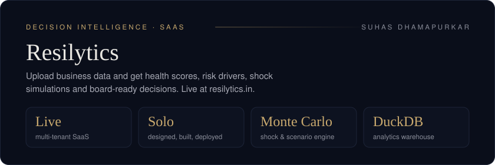

<div align="center">




</div>

<div align="center">

<b><a href="https://resilytics.in">🌐 resilytics.in</a></b> &nbsp;·&nbsp; <b><a href="https://drive.google.com/file/d/1vxAe692qf56R729f54DHMTx1ZgMvfiDG/view?usp=sharing">▶ Watch the demo</a></b>

</div>

> **In one line:** Resilytics helps founders, CFOs and strategy teams decide what to do next from their sales and revenue data. It finds where the business is going wrong, which areas to improve first, and what happens under different scenarios.

## The problem

Most companies have dashboards but still struggle with three questions:

1. **Where are we going wrong?** Which products, regions or customers are dragging revenue down?
2. **What should we fix first?** Which risks matter most for revenue?
3. **What happens if…?** What would a price change, a lost customer or a market shock do to us?

Resilytics answers them in one workflow, rather than adding another dashboard.

## How it works

```text
Upload / connect data  →  Validate & model  →  Business health
        →  Risk drivers  →  Shock & scenario simulation  →  Board-ready report
```

| Module | What it does |
| --- | --- |
| **Data onboarding** | CSV/Excel upload with schema detection, preview and validation; rejected rows are explained, not hidden |
| **Business Health** | Executive summary of performance and structural stability |
| **Risk Drivers** | Concentration and risk metrics (HHI, VaR-95, modified Altman Z-Score) that show what is driving risk |
| **Shock Simulator** | Monte Carlo simulation of downside shocks |
| **Decision Scenarios** | Side-by-side comparison of strategic options |
| **Reports** | Exportable, board-ready decision summaries |

## Architecture

Built end to end as a modular monolith with clear service boundaries.

| Layer | Technology |
| --- | --- |
| API | FastAPI (Python) |
| Transactional store | PostgreSQL with SQL-layer tenant isolation |
| Jobs and caching | Redis + RQ async workers |
| Analytics warehouse | DuckDB |
| Frontend | React, TypeScript, Vite, Tailwind, React Query, Recharts |
| Delivery | Docker, explicit database migrations, automated release checks |

**Engineering highlights**

- Multi-tenant by design, with tenant isolation enforced in the SQL layer.
- Dataset versioning with ingestion stage counts, rejection reasons and trust indicators.
- Heavy simulations run as async jobs so the UI stays responsive.
- Demo-state tooling resets a tenant to zero-data, sample-data or live-data presets.

## Status

Live at resilytics.in and tested on 4 years of synthetic company data. An innovative project where I applied both data analytics (SQL, Python, statistical risk models) and AI (an assistant grounded in the analysed data).

## About this repository

This is the **public overview** of Resilytics. The full application source is kept private; this repo contains the README, licence and backend container setup. For a walkthrough, see the [demo video](https://drive.google.com/file/d/1vxAe692qf56R729f54DHMTx1ZgMvfiDG/view?usp=sharing) or [get in touch](mailto:suhasdhamapurkar1710@gmail.com).

---

<div align="center">
<sub>Built by <a href="https://github.com/Suhas5497"><b>Suhas Dhamapurkar</b></a> — Data Analyst &amp; AI/ML Engineer · Open to full-time Data Analyst roles<br>
<a href="https://linkedin.com/in/suhas-1710d">LinkedIn</a> · <a href="https://portfolio-git-main-suhasdhamapurkar1710-gmailcoms-projects.vercel.app/">Portfolio</a> · <a href="mailto:suhasdhamapurkar1710@gmail.com">Email</a></sub>
</div>
